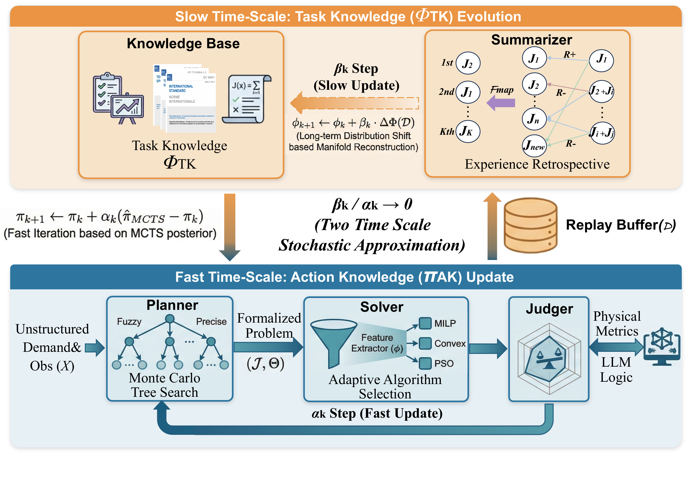
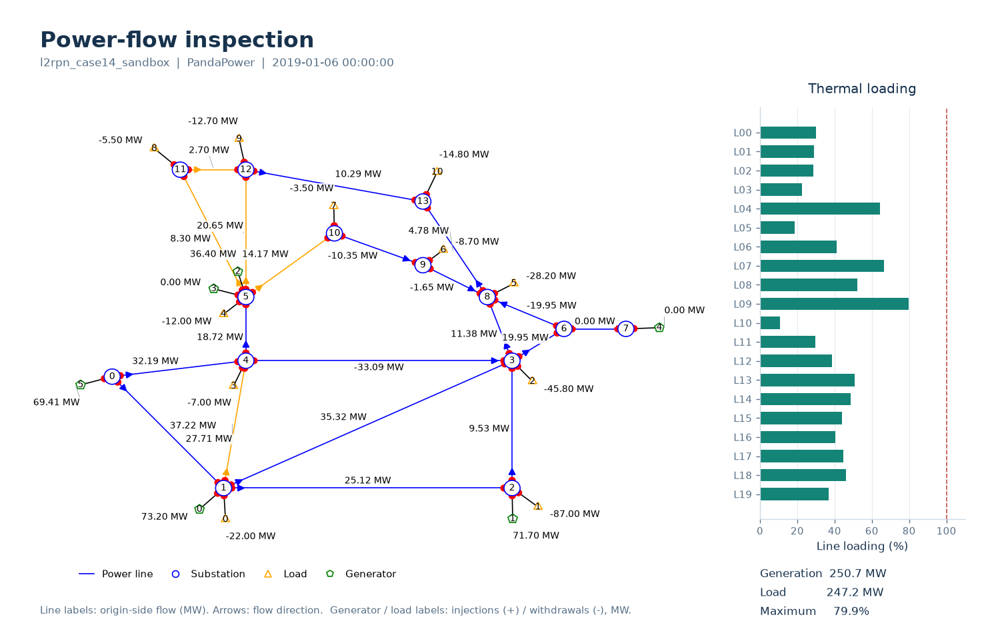
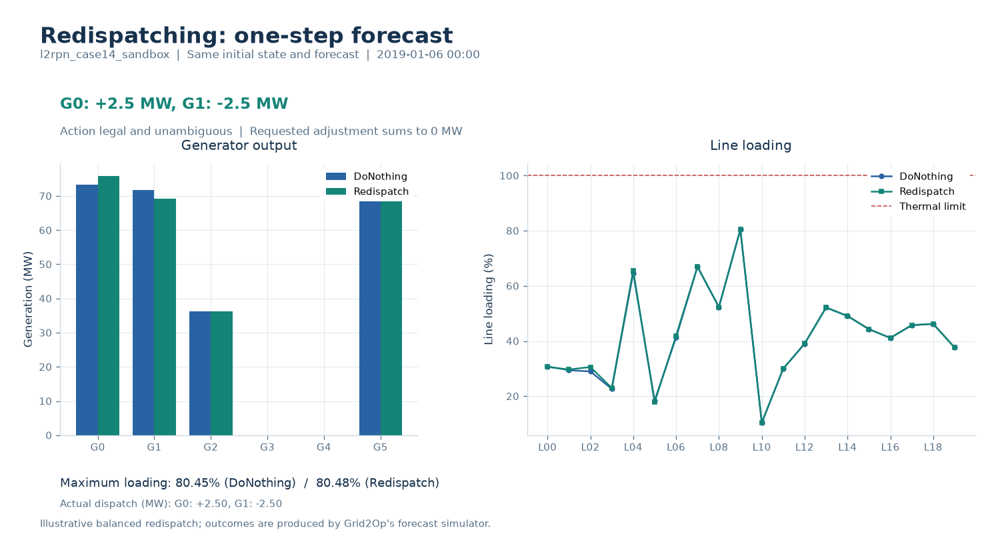
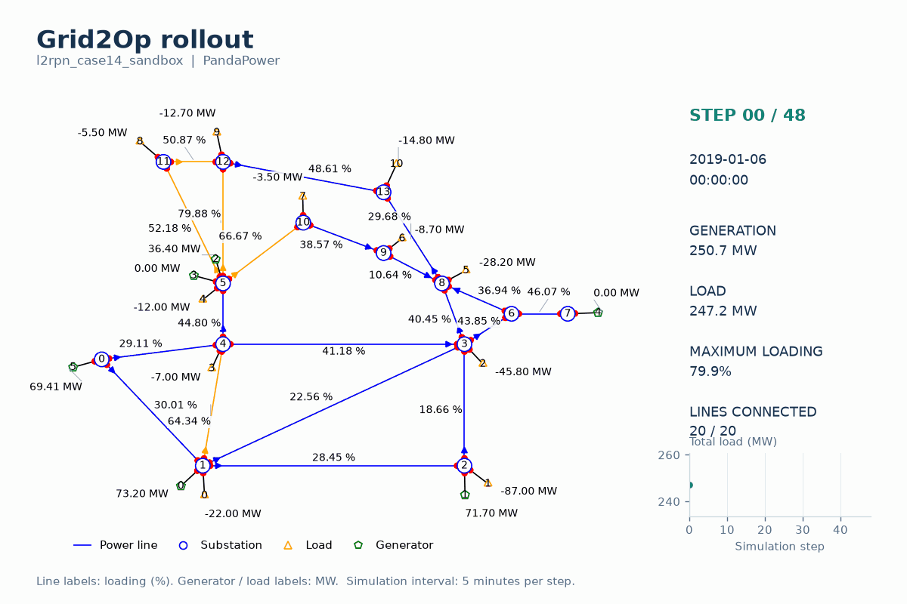

# ADA: Agile Dispatch Agent

ADA is an LLM-based framework for end-to-end power system dispatch. It separates fast planning and solver selection from slow knowledge evolution to address attribution ambiguity under ambiguous requirements and changing grid conditions.

## Overview

ADA consists of four cooperating modules:

1. **Planner:** actively acquires missing grid information and translates dispatch requirements into mathematical formulations.
2. **Solver:** matches problem features to algorithm capabilities and selects a suitable solver.
3. **Judger:** combines physical validation with logical evaluation to provide feedback on dispatch decisions.
4. **Summarizer:** uses verified trajectories to refine Action Knowledge and reconstruct Task Knowledge.

Action Knowledge supports fast adaptation of tool-use strategies, while Task Knowledge evolves on a slower time scale to revise formulation priors.

## Demonstrations

### Power Flow

Power-flow snapshot in the Grid2Op `l2rpn_case14_sandbox` environment, showing grid topology, active power flows, generation, loads, and line loading.

### Redispatching

One-step predictions from the same initial state in `l2rpn_case14_sandbox`: DoNothing versus a scripted, balanced redispatch action.

### Grid2Op Rollout

Static-ADA (left) and Static-ADA-High (right) rollouts in l2rpn_case14_sandbox, using the same scenario, seed, and 48-step horizon.

  
  

